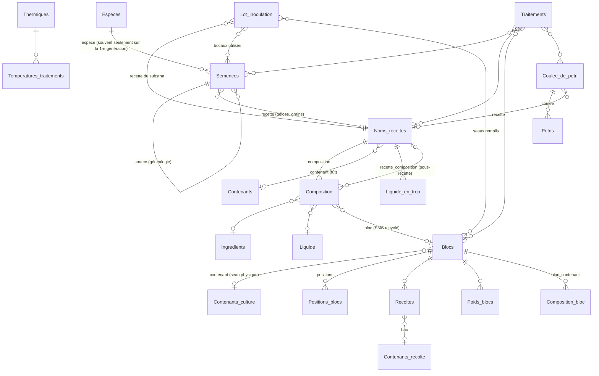

> **Copie du 26/10/2026.** La source de vérité est le dépôt du logiciel de culture (Django) : cette copie peut vieillir.

# Domaine — La culture des champignons dans la base de données

Ce document explique la partie « culture » de la base Karulium : **ce que chaque table représente dans le travail réel de la champignonnière**, comment elles sont reliées, et pourquoi elles ont été construites comme ça. Il couvre les apps `Especes`, `Semences`, `Recettes`, `Traitements`, `Blocs`, `Recoltes`, `Mesures`, `Objets`, `Contaminations`, `Problemes` et les briques transverses de `Features` (remarques, photos).

Les chiffres cités viennent de la base de production au 25/10/2026. Ils servent à montrer ce qui est vraiment utilisé et ce qui ne l'est pas.

> Pour le détail technique des semences (remarques en attente, filtrage polymorphique), voir aussi [semences.md](semences.md).

---

## 1. Le métier en une page

Cultiver des champignons, c'est **multiplier un mycélium pur**, puis lui donner un **substrat nourricier débarrassé de ses concurrents**, et enfin le placer dans des **conditions qui le font fructifier**. À chaque étape, l'ennemi est la **contamination** : moisissures (Trichoderma surtout), bactéries, levures. Un mycélium qui pousse sur un substrat sans concurrent gagne la course. S'il y a un concurrent, il la perd.

Le cycle à Karulium :

```
 Achat de souche          Multiplication en labo               Production en serre
 ───────────────          ──────────────────────               ───────────────────
 Espèce / souche  ──►  Seringue / Pétri  ──►  Bocaux de grains  ──►  Seaux (blocs)  ──►  Récoltes
 (ME-P40, ...)         (gélose stérile)       (« spawn »)            de substrat          (volées)
                            │                      │                      ▲
                            └── repiquages ────────┘                      │
                                                                 Recette de substrat
                                                                 (bagasse, bois, Purina…)
                                                                 pasteurisée en fût
```

1. **Espèce/souche** : on achète une génétique (code fournisseur `ME-…`). C'est l'origine de tout.
2. **Laboratoire** : on la fait pousser sur gélose (boîte de **Pétri**), ou en **culture liquide** (seringue, bocal liquide). On repique pour garder une culture propre et en multiplier la quantité.
3. **Semence de production (« spawn »)** : on inocule des **bocaux de grains** stérilisés (maïs, millet…). Le mycélium colonise le grain. Un bocal colonisé sert à inoculer d'autres bocaux (expansion) ou des seaux.
4. **Substrat** : on prépare un mélange (bagasse, bois broyé, aliment Purina, chaux…), on l'humidifie et on le **pasteurise à la vapeur** dans un fût.
5. **Inoculation** : dans une même séance, on mélange plusieurs bocaux de spawn avec le substrat pasteurisé et on remplit une série de seaux. Ce lot de travail est un **lot d'inoculation**.
6. **Incubation puis fructification** : le seau (le **bloc**) est placé dans une serre. Le mycélium envahit le substrat, puis des champignons sortent par les trous. La médiane entre inoculation et première récolte est de **28 jours**.
7. **Récoltes** : un bloc produit plusieurs **volées** (5,3 récoltes par bloc en moyenne, ~188 g par récolte). On pèse chaque récolte et on la met dans un **bac** qui part en chambre froide puis à la vente.
8. **Fin de cycle** : le bloc épuisé est sorti. Son substrat usé (SMS, *spent mushroom substrate*) peut servir d'ingrédient pour une nouvelle culture. Le seau est lavé et réutilisé.

**Toute la base est construite pour pouvoir remonter cette chaîne à l'envers** : à partir d'une récolte (ou d'une contamination), retrouver le bloc, le lot, la recette, la pasteurisation, les bocaux, leurs parents, jusqu'à la souche achetée. C'est la clé pour comprendre *pourquoi* un lot a bien ou mal marché.

---

## 2. Vue d'ensemble des tables



Les **remarques**, **photos**, **contaminations** et **problèmes** ne figurent pas sur le schéma : ils s'attachent à *n'importe quelle* table via une relation générique (voir §11).

### Volumes réels (prod, 25/10/2026)

| Table | Lignes | Commentaire |
|---|---:|---|
| `Especes` | 54 | souches achetées ou locales |
| `Semences` | 11 388 | dont 10 587 bocaux, 728 pétris, 73 seringues, 95 cultures liquides |
| `Coulee_de_petri` | 9 | peu utilisé |
| `Noms_recettes` | 645 | 168 recettes de semence, 477 recettes de substrat |
| `Composition` | 2 452 | lignes d'ingrédients des recettes |
| `Ingredients` | 48 | |
| `Lot_inoculation` | 673 | ~11 bocaux et ~11 seaux par lot en moyenne |
| `Blocs` | 7 572 | un bloc = un cycle de culture dans un seau |
| `Seaux` (contenants) | 1 502 | seaux physiques, réutilisés ~5 fois |
| `Recoltes` | 27 255 | 5,1 tonnes depuis octobre 2024 |
| `Contenants_recolte` (bacs) | 45 | |
| `Thermiques` | 448 | 313 pasteurisations vapeur, 108 stérilisations |
| `Trempage` | 68 | |
| `Poids_blocs` | 7 805 | pesée des seaux à l'inoculation |
| `Contaminations` | 1 341 | 903 sur bocaux, 394 sur blocs, 44 sur pétris |
| `Remarques` | ~5 700 | surtout sur récoltes, bocaux, blocs, lots |
| `Images` | ~1 260 | surtout sur blocs et pétris |

---

## 3. `Especes` — la génétique

Une ligne = **une souche**, pas une espèce botanique. Exemple : *Pleurotus djamor* existe en plusieurs lignes (`ME-P40`, `ME-P39`, `ME-CP018` « Valentine », `ME-CP008` « Sakura »…).

| Champ | Rôle métier |
|---|---|
| `nom` | nom d'usage (souvent le nom anglais du fournisseur : *Pink Oyster*, *Lion's Mane*) |
| `nom_genre`, `nom_espece` | nom scientifique (*Pleurotus*, *djamor*) |
| `souche` | code fournisseur de la souche (`ME-P40`) |
| `origine` | provenance |
| `nom_commercial` | **nom vendu au client** (factures, site) : « Pleurote Rose Sakura » |
| `odoo_product_template_id`, `odoo_last_sync` | lien avec le produit Odoo |

**Pourquoi par souche ?** Deux souches de la même espèce n'ont ni le même rendement, ni la même vitesse, ni la même tolérance à la chaleur guadeloupéenne. Pour décider quelle souche garder, il faut comparer les souches entre elles, pas les espèces.

**Pourquoi un nom commercial séparé ?** Le nom du fournisseur (« Florida Oyster ME-P16 ») ne parle pas au client. Le nom commercial est celui qui part sur la facture et sur karulium.bio, d'où la synchronisation Odoo portée par cette table.

Méthodes utiles : `semences()` (toute la descendance de la souche), `petris()`, `bocaux()`, `graph()` (arbre généalogique pour l'affichage), `blocs_actifs()`.

---

## 4. `Semences` — le laboratoire et la généalogie

### 4.1 Un modèle polymorphique

`Semences` est une classe mère (`django-polymorphic`) avec un enfant par **type de contenant** :

| Enfant | Ce que c'est | Champs propres |
|---|---|---|
| `Petris` | boîte de gélose | `coulee` (série de coulage), `taille` (90 ou 40 mm), `date_colonisation` |
| `Bocaux` | bocal, de grains (spawn) ou liquide | `date_colonisation`, `colonisation`, `bloc` |
| `Seringues` | culture liquide en seringue (souvent l'achat initial) | — (`liquide` forcé à vrai) |
| `Erlenmeyers` | culture liquide en erlenmeyer | — (`liquide` forcé à vrai) — 0 ligne |
| `Slants` | tube de gélose incliné, conservation au froid | `date_refrigeration` — 0 ligne |

**Pourquoi le polymorphisme ?** Tous ces objets ont le même rôle dans la chaîne : ils contiennent du mycélium, ont un parent, une date d'inoculation, peuvent être contaminés et peuvent être utilisés pour inoculer autre chose. Une seule table mère permet qu'**un bocal ait pour parent un pétri, qui a pour parent une seringue**, avec une seule clé `source`. Les enfants n'ajoutent que ce qui est propre au contenant.

**Pourquoi `liquide` est un booléen et pas une classe ?** Le contenant (bocal, seringue…) et l'état (solide/liquide) sont deux choses indépendantes : un bocal peut contenir des grains ou une culture liquide. Une ancienne classe `Lc` mélangeait les deux et a été supprimée en juin 2026.

### 4.2 Champs communs

| Champ | Rôle métier |
|---|---|
| `identifiant` | l'étiquette écrite ou le QR sur le contenant : `B327`, `P55` |
| `espece` | la souche. **Souvent renseignée seulement sur la première génération** (voir 4.3) |
| `recette` | le milieu : gélose (« Agar classique ») ou grains (« Maïs en grain ») |
| `source` | **la semence parente** dont on a prélevé le mycélium |
| `date_inoculation` | date d'inoculation, ou d'achat pour une souche achetée |
| `date_fin` | date où la semence est jetée ou terminée |
| `absence_croissance` | le mycélium n'a pas démarré |
| `emplacement` | étagère du labo : `G-1-1` … `D-4-4` (Gauche/Droite – étage – position), ou `Table` |
| `dernier_inventaire` | dernière fois qu'on a vérifié physiquement que la semence est là |
| `vendu` | vendue à un client (spawn vendu) |
| `liquide` | culture liquide |

### 4.3 La généalogie par `source`

`source` est une clé étrangère vers `Semences` elle-même : chaque semence connaît son parent. On obtient un **arbre** :

```
Seringue ME-P40 (achat)
 └── Pétri P12
      ├── Pétri P30         (repiquage : génération 2 sur pétri)
      │    └── Bocal B101
      │         ├── Bocal B205   (expansion grain → grain)
      │         └── Bocal B206
      └── Bocal B102
```

Transitions observées en base : bocal → bocal (8 392), pétri → bocal (1 778), seringue → pétri (475), pétri → pétri (231), seringue → bocal (194).

**Pourquoi c'est important pour le cultivateur :**
- **Traçabilité des contaminations** : si plusieurs bocaux frères sont contaminés, le parent est suspect. `soeurs()` donne les semences issues du même parent le même jour.
- **Sénescence** : un mycélium repiqué trop de fois s'affaiblit. `generation()` compte les repiquages successifs **dans le même type de contenant** (pétri → pétri → pétri = génération 3). Passer d'un pétri à un bocal ne compte pas comme une nouvelle génération, car c'est le parcours normal et non un repiquage d'entretien.
- **Héritage de l'espèce** : on ne ressaisit pas la souche à chaque bocal. `nom_espece()` remonte la chaîne `source` jusqu'à trouver une `espece`. `especes_par_semence()` fait la même chose pour toutes les semences en mémoire, en 1 requête au lieu d'une par génération.
- **`PROTECT` sur `source`** : on ne peut pas supprimer un parent qui a des enfants, sinon l'arbre serait coupé.

### 4.4 Quand une semence est-elle « active » ?

`actif()` renvoie faux si la semence :
- a une `date_fin`, **ou**
- a été utilisée dans un lot d'inoculation (elle est partie dans des seaux), **ou**
- est un **bocal qui a déjà des enfants** (un bocal de grains ouvert pour inoculer d'autres bocaux est considéré comme consommé).

Un pétri qui a des enfants reste actif : on prélève plusieurs fois dans un même pétri. Il n'y a donc pas besoin de saisir une date de fin pour chaque bocal utilisé : l'utilisation suffit à le sortir du stock. `vraie_date_fin()` donne la date de fin saisie, ou à défaut la date du lot qui l'a consommé.

### 4.5 `Coulee_de_petri`

Une coulée = **une séance où l'on coule une série de pétris** avec la même gélose (`recette`, `nombre`). La coulée peut recevoir un traitement (stérilisation) via `Traitements.coulee`. Si toute une coulée se contamine, c'est la stérilisation ou la gélose qu'il faut accuser, pas la souche.

### 4.6 `RemarqueEnAttente`

Note préparée pour une semence qui **n'existe pas encore** (on étiquette un bocal avant de le saisir). Elle est appliquée automatiquement à la création d'une semence portant cet identifiant. Détails dans [semences.md](semences.md).

---

## 5. `Recettes` — ce que mange le champignon

### 5.1 `Noms_recettes` : une préparation réelle, pas une fiche-type

Une ligne de `Noms_recettes` n'est **pas** une recette au sens livre de cuisine. C'est **une préparation datée** : « la gélose coulée le 3 mars », « le fût de substrat préparé le 12 avril ». D'où 645 recettes pour 48 ingrédients.

| Champ | Rôle |
|---|---|
| `nom` | facultatif. Sans nom, la recette s'affiche par sa composition (« Bagasse + Purina + Chaux ») |
| `date_preparation` | date de la préparation |
| `semence` | **vrai** = milieu de laboratoire (gélose, grains pour bocaux), **faux** = substrat pour seaux |
| `contenant` | le fût où le substrat a été préparé et pasteurisé (`Futs`) |

**Pourquoi une préparation par ligne ?** Pour l'expérimentation. Chaque fût a ses proportions exactes, sa pasteurisation, son eau, ses lots d'inoculation et donc ses rendements. `taux_contamination()` et `total_recoltes()` mesurent le résultat de **cette** préparation. Une fiche-type partagée effacerait les variations, alors que ce sont elles qu'on cherche à comparer.

### 5.2 `Composition` : les lignes d'une recette

Chaque ligne contient une quantité (en grammes) et **un seul** des composants suivants :

| Composant | Exemple | Pourquoi |
|---|---|---|
| `ingredient` | 3 000 g de bagasse | cas normal |
| `liquide` | 5 000 g d'eau agricole | l'eau est un vrai paramètre (potable, javélisée, de coco, jus de canne…) |
| `recette_composition` | 2 000 g de la recette 412 | une recette peut réutiliser une préparation antérieure (pré-mélange) |
| `bloc` | 4 000 g du bloc 1 293 | **recyclage du substrat usé (SMS)** d'un ancien bloc |

`composition2()` « aplatit » tout ça en ingrédients de base : un bloc recyclé est remplacé par sa propre recette, au prorata de son poids. On sait ainsi qu'un seau contient en réalité X g de bagasse, même si une partie vient d'un ancien bloc. `pourcentage()` donne la part de chaque ligne.

### 5.3 Ingrédients et liquides

- `Ingredients` : `nom`, `type` parmi **BASE** (bagasse, bois de manguier, herbe de Guinée…), **PURINA** (aliments pour animaux utilisés comme supplément azoté : « 5402 – Truie en gestation »…), **GRAINS** (maïs, millet), **POUDRE** (agar, farines locales, marc de café), **MINERAUX** (chaux). Le type sert à raisonner en équilibre carbone/azote : la base apporte le carbone, le Purina et les grains l'azote, la chaux corrige le pH.
- La variété des ingrédients locaux (bagasse, fruit à pain, manioc, pois d'angole) reflète un choix : **valoriser les ressources de Guadeloupe** plutôt qu'importer de la paille.
- `Liquide` : eau potable, agricole, javélisée, condensée, eau de coco, jus de canne, miel… Peut aussi être le jus d'une recette ou d'un ingrédient.
- `Liquide_en_trop` (431 lignes) : **le liquide préparé mais pas versé**. On prépare un volume d'eau, on en verse une partie selon l'humidité du mélange, et on pèse le reste. Indispensable pour connaître l'eau réellement apportée. Voir la commande `analyser_eau_pasteurisation`, qui compare l'eau apportée par la vapeur à la théorie.
- `Prix_ingredients` : achat (prix, quantité, fournisseur, date), pour le calcul des coûts.

### 5.4 `Composition_bloc` : la composition propre à un seau

`Composition_bloc` décrit le contenu d'un **bloc** sans passer par une recette : surtout pour les **blocs SMS**, fabriqués en mélangeant le contenu d'anciens blocs (`blocs`, `related_name='blocs_fusiones'`). `Blocs.SMS()` renvoie vrai pour un bloc sans lot d'inoculation mais composé d'autres blocs. Peu utilisé en pratique (6 lignes).

### 5.5 La filière substrat amont (prévue, non utilisée)

`Recolte` (coupe d'un ingrédient en un lieu, ex. du bois), `Substrat` (séchage, broyage, granulométrie), `Sacs_remplis` (stockage en sacs, fusion de sacs), `Densite`, et `Constituant`/`CompositionIngredient` (analyse nutritionnelle d'un aliment : protéines %, etc.) décrivent la vie de la matière première **avant** la recette. Ces tables sont **vides**. Elles traduisent une ambition de traçabilité totale (le bois de manguier coupé tel jour à tel endroit, séché X jours, broyé à 12 mm) qui n'a pas été mise en pratique.

> Attention : `Recettes.Recolte` (coupe d'un ingrédient) n'a rien à voir avec `Recoltes.Recoltes` (récolte de champignons).

---

## 6. `Traitements` — ce qu'on fait subir à la matière

`Traitements` est polymorphique. Tout traitement a une `date_debut`, une `date_fin` (contrainte en base : fin > début) et peut viser, par relations plusieurs-à-plusieurs, des `semences`, des `blocs`, des `recettes`, des `composition` ou des `coulee`.

| Enfant | Usage réel | Lignes |
|---|---|---:|
| `Thermiques` | `type` : stérilisation sèche (53), stérilisation humide (55, autocuiseur pour bocaux et gélose), **pasteurisation vapeur (313, le substrat en fût)**, cuisson (27) | 448 |
| `Trempage` | trempage des grains ou du substrat, avec `liquide` et `quantite_liquide` | 68 |
| `Chimiques`, `Electriques`, `Hydriques`, `Biologiques`, `Lumiere`, `Lavage`, `sechage` | prévus, vides | 0 |

**Pourquoi des relations plusieurs-à-plusieurs ?** Une pasteurisation traite **un fût, donc une recette entière**. Une stérilisation à l'autocuiseur traite **plusieurs bocaux à la fois**. Le même passage en autocuiseur peut contenir des bocaux et une coulée de pétris. Un traitement est un **événement physique** (« l'autocuiseur a tourné de 9 h à 11 h 30 ») qui touche plusieurs objets. En pratique, 395 thermiques visent des recettes, quelques-uns des coulées.

**Pourquoi c'est important ?** La pasteurisation est l'étape où se joue la contamination des seaux. Sa durée (`duree()`) et ses températures (`Temperatures_traitements`, liées aux `Thermiques`) permettent de relier « seaux contaminés » à « pasteurisation trop courte ».

---

## 7. `Lot_inoculation` — le pivot de toute la base

C'est **la table centrale** : elle relie le laboratoire à la serre.

| Champ | Rôle |
|---|---|
| `date` | la séance d'inoculation |
| `recette` | la recette de substrat utilisée (le fût) |
| `semences` (M2M) | les bocaux de spawn versés (~11 en moyenne) |
| `Blocs` (M2M, majuscule historique) | les seaux remplis (~11 en moyenne) |
| `quantite_semences` | poids de spawn, quand les bocaux n'ont pas été pesés |

**Pourquoi un lot plutôt qu'un lien direct bocal → seau ?** Sur le terrain, on **mélange** les bocaux avec le substrat avant de remplir les seaux. Impossible de dire quel bocal est allé dans quel seau. Le lot représente fidèlement cette réalité : « ces N bocaux + ce substrat ont donné ces M seaux ». C'est aussi l'unité naturelle pour comparer les résultats.

Ce que le lot permet de calculer :
- `espece()` : la souche du lot, déduite des bocaux. Renvoie « Problème ! » si on a mélangé deux souches.
- `poids_total_blocs()` : substrat inoculé = somme des **premières pesées** des seaux moins la **tare de 268 g** (`TARE_SEAU`).
- `poids_total_semences()` : spawn utilisé.
- `poids_total_recoltes()` : production totale du lot.
- D'où l'**efficacité biologique** (récolte / substrat) et le **taux de spawn** (spawn / substrat), les deux indicateurs clés du cultivateur.

Les variantes `especes_par_lot()`, `poids_blocs_par_lot()` et `poids_recoltes_par_lot()` calculent la même chose pour tous les lots en 2 ou 3 requêtes (listes, tableaux de bord).

> Pour l'analyse de l'eau, agréger **par recette** et non par lot : une même recette peut alimenter plusieurs lots.

---

## 8. `Blocs`, contenants et emplacements — la vie en serre

### 8.1 `Blocs` : un cycle de culture, pas un seau

Un **bloc** = **un cycle de culture dans un seau**. Le seau physique est un `Contenants_culture` (enfant `Seaux`). Le même seau `S1293` sera, au fil du temps, plusieurs blocs successifs. 7 572 blocs pour 1 502 seaux : chaque seau a servi environ 5 fois.

**Pourquoi séparer le bloc du seau ?** Parce qu'on réutilise les seaux. Le QR collé sur le seau identifie le récipient, pas son contenu. En séparant les deux, on conserve l'historique complet de chaque cycle (lot, récoltes, contaminations) même après le lavage et la réutilisation du seau.

| Champ | Rôle |
|---|---|
| `contenant` | le seau physique (`Seaux` : transparent 10 L, opaque 10 L, petit 5 L) |
| `date_fin` | fin du cycle (bloc sorti de la serre) |
| `dernier_inventaire` | dernière vérification physique |

Méthodes métier :
- `lot()`, `espece()`, `recette()` : remontent la chaîne.
- `age()` : jours depuis l'inoculation (ou depuis la date de fin).
- `total_recolte()`, `derniere_recolte()`.
- `caracteristiques()` : diagnostic rapide (bloc jeune < 90 j / vieux, pas de récolte depuis plus de 40 j, première récolte tardive au-delà de 50 j).
- `est_vendu()` / `info_vente()` : un bloc entier peut être vendu à un client (`CRM.VenteBloc`, OneToOne `vente`).

### 8.2 `Positions_blocs` et `LocalisationPersonnalisee`

Les serres sont organisées en **piles** de seaux : `serre` (1 ou 2) / `cote` (G ou D) / `rangee` / `colonne` / `hauteur`. Chaque déplacement crée une nouvelle ligne et l'ancienne passe à `actuel=False` : on garde **l'historique des positions**.

Quand un bloc est terminé (`date_fin` renseignée), un signal **recompacte la pile** : les seaux du dessus descendent d'un cran, comme sur le terrain. Hors serre (labo, chambre froide…), on utilise une `LocalisationPersonnalisee`.

**Pourquoi ce niveau de détail ?** La position influe sur la production (chaleur en haut de pile, courant d'air, lumière). Connaître la position permet de relier un rendement faible à un emplacement, et de retrouver physiquement un seau dans une serre qui en contient des centaines.

### 8.3 `NotationBloc`

Note de 1 à 5 étoiles sur un bloc, avec remarque et photos. Prévue, pas encore utilisée (0 ligne).

---

## 9. `Recoltes` — ce qui sort de la serre

| Champ | Rôle |
|---|---|
| `bloc` | le bloc récolté |
| `bloc_bocal` | fructification directe en bocal (prévu, non utilisé) |
| `poids` | en **grammes** (0 à 10 000) |
| `date` | |
| `recolteur` | Gaël (0), Zilca (1), Francis (2) |
| `contenant` | le **bac** (`Contenants_recolte`) dans lequel la récolte est déposée |
| `saisie_manuelle` | vrai si saisie sans la balance connectée |

- `portee()` : numéro de la **volée** (1re, 2e, 3e récolte du bloc). Les volées successives produisent de moins en moins : c'est ce qui décide du moment où sortir un bloc.
- `age()` : jours entre l'inoculation du lot et cette récolte.

**Pourquoi le bac ?** Le bac fait le lien entre la production et la vente. On remplit un bac un jour de récolte, il part en chambre froide puis en préparation de commande. Savoir quels blocs (donc quels lots et quelles recettes) sont dans quel bac permet la gestion FIFO et la traçabilité jusqu'au client.

- `NotationBac` : note de 1 à 5 sur les **conditions** d'un bac à une date donnée (température, humidité), pour séparer l'effet des conditions de l'effet du substrat.
- `Fin_bacs` : **abandonné** (11 lignes, la dernière en juillet 2025). Pour savoir ce que contient un bac, partir de sa dernière session de récolte (`_contenu_bac()` dans `Recoltes/views.py`).

---

## 10. `Mesures` et `Objets` — instruments et contenants

### `Mesures` (polymorphique)
Toute mesure a une valeur (`mesure`), une `date` et un `instrument` (`Instruments` : nom, marque, précision, unité, `valide`). Garder l'instrument permet d'écarter les mesures d'un capteur défaillant.

| Enfant | Rattaché à | Usage |
|---|---|---|
| `Poids_blocs` | `Blocs` | **pesée du seau à l'inoculation** (7 805) : base de tous les calculs de substrat |
| `Poids_bocaux` | `Bocaux` (semences) | poids de spawn (237) |
| `Temperatures_traitements` | `Thermiques` | courbe de température d'une pasteurisation (45) |
| `Poids_sacs` | `Sacs_remplis` | prévu (0) |

`Temperatures_serres` est une table à part (12 lignes, historique). La météo et les capteurs des serres vivent aujourd'hui dans **InfluxDB**, pilotés par `Pilotage_serres`.

### `Objets`
- `Contenants_culture` → `Seaux` (et `Bocaux`, inutilisé) : récipients de culture.
- `Contenants_recolte` : bacs de récolte (45).
- `Contenants` → `Futs` (7, où l'on prépare et pasteurise le substrat), `Sacs`, `Autres_contenants`.

> **Piège de nom** : `Objets.Bocaux` (contenant de culture, 0 ligne) et `Semences.Bocaux` (semence en bocal, 10 587 lignes) sont deux classes différentes portant le même nom. Toujours importer en précisant l'app.

---

## 11. Briques transverses : remarques, photos, contaminations, problèmes

Ces quatre tables utilisent une **relation générique** (`content_type` + `object_id`) : une même table peut s'attacher à un bocal, un bloc, une récolte, une recette, un lot ou un traitement.

**Pourquoi générique ?** Le cultivateur observe et photographie *tout* : un pétri qui verdit, un seau qui sent mauvais, une récolte abîmée, un fût trop humide. Une table par type d'objet aurait multiplié les tables pour le même geste. Avec une table unique, on peut aussi poser des questions transversales (« toutes les contaminations du mois, quel que soit l'objet »).

| Table | Rôle | Usage réel |
|---|---|---|
| `Remarques` | note libre datée | ~5 700, surtout sur récoltes, bocaux, blocs, lots, recettes |
| `Images` | photo datée, stockée dans `uploads/{modèle}/{id}/`. Une photo peut être « orpheline » en attendant d'être rattachée | ~1 260, surtout blocs et pétris |
| `Contaminations` | une contamination observée, liée à un `Contaminants` | 1 341 |
| `Probleme` | anomalie de données ou de terrain (type, gravité, résolu) | 4 |

`Contaminants` est le catalogue des contaminants : Trichoderma (353), « Diverses » (568), « Inconnue » (196), Noire, Jaune, Bactérie, Neurospora, Points blancs, « Suspicion »… Les catégories visuelles (« Vert pâle », « Poudre chocolat ») traduisent la réalité du terrain : on note ce qu'on voit, sans pouvoir identifier au microscope. `get_date_inoculation()` permet de calculer **à quel âge** la contamination apparaît : précoce = substrat ou pasteurisation, tardive = environnement de la serre.

La relation générique est déclarée sur chaque modèle concerné (`contaminations = GenericRelation(Contaminations)`), ce qui permet d'écrire `bloc.contaminations.all()`. Le symbole ☠ dans l'affichage d'un bloc ou d'un bocal signale une contamination.

---

## 12. Parcours concrets dans la base

### « Ce seau a été contaminé : pourquoi ? »
```
Blocs ─► lot() ─► Lot_inoculation
                    ├─► recette ─► Noms_recettes ─► Composition (ingrédients, eau, SMS)
                    │                 └─► Traitements (Thermiques : durée de pasteurisation, températures)
                    └─► semences ─► Bocaux ─► source ─► … ─► Petris ─► Seringue ─► Especes
```
On regarde ensuite si les **frères** (autres blocs du lot, autres bocaux du même parent) sont aussi contaminés : si tout le lot l'est, c'est le substrat ou la pasteurisation ; si toute une descendance l'est, c'est la semence.

### « Quelle souche, quelle recette produit le plus ? »
Pour chaque lot : `poids_total_recoltes() / poids_total_blocs()` = efficacité biologique. On regroupe par `espece()` ou par composition de `recette`. Les méthodes `*_par_lot()` font ce calcul en masse.

### « Que contient ce bac en chambre froide ? »
`Contenants_recolte` → `Recoltes` de sa dernière session de remplissage → `bloc` → lot → espèce.

### « Quelles souches risquent d'être perdues ? »
`Especes.semences()` → filtrer les semences `actif()` → regarder `age()` et `dernier_inventaire`. (L'outil de rappel automatique est au backlog, voir [BACKLOG_IDEES.md §8](../BACKLOG_IDEES.md).)

---

## 13. Pourquoi ces choix, en résumé

| Choix | Raison métier |
|---|---|
| Une `Especes` par **souche** | on compare et on vend des souches, pas des espèces |
| `Semences` polymorphique + `source` | un même arbre généalogique traverse seringues, pétris et bocaux |
| L'espèce héritée par la généalogie | on ne ressaisit pas la souche à chaque bocal ; l'arbre fait foi |
| « Actif » déduit de l'usage | un bocal versé dans un lot sort du stock sans saisie supplémentaire |
| Une `Noms_recettes` par **préparation** | chaque fût est une expérience dont on mesure le résultat |
| Composition récursive (sous-recettes, blocs) | le substrat usé et les pré-mélanges sont des ingrédients réels |
| Traitements en plusieurs-à-plusieurs | une pasteurisation ou un passage en autocuiseur traite plusieurs objets en même temps |
| `Lot_inoculation` entre bocaux et seaux | sur le terrain on mélange : le lot est l'unité réelle de travail et d'analyse |
| `Blocs` ≠ `Seaux` | les seaux sont réutilisés ; l'historique appartient au cycle de culture |
| Positions historisées par pile | la place dans la serre influence la production, et il faut retrouver les seaux |
| Récoltes pesées au gramme + bac | rendement par volée et traçabilité jusqu'à la vente |
| Remarques/photos/contaminations génériques | on observe tout, avec le même geste, sur n'importe quel objet |
| `null=True, blank=True` presque partout | la saisie se fait sur le terrain, souvent incomplète ; mieux vaut une donnée partielle qu'aucune |

---

## 14. Points d'attention (état réel des données et du code)

1. **`Blocs.date_fin` n'est pas toujours renseignée** : 3 576 blocs sont « actifs » (sans date de fin), mais seulement ~900 ont été récoltés dans les 60 derniers jours. Pour compter les blocs réellement en serre, croiser avec la date de dernière récolte ou la position actuelle.
2. **L'espèce d'une semence n'est souvent que sur l'ancêtre** : toujours passer par `nom_espece()` / `especes_par_semence()`, jamais par `semence.espece` directement.
3. **`Lot_inoculation.recette` est en `CASCADE`** : supprimer une recette supprimerait les lots qui l'utilisent. Ne jamais supprimer une recette utilisée.
4. **Tables prévues mais vides** : `Recolte`, `Substrat`, `Sacs_remplis`, `Densite`, `Constituant`, `CompositionIngredient`, `Poids_sacs`, les traitements autres que thermique/trempage, `Erlenmeyers`, `Slants`, `NotationBloc`, `Recoltes.bloc_bocal`, `Localisations_internes`. Ne pas supposer qu'elles reflètent l'activité.
5. **`Fin_bacs` abandonné**, voir §9.
6. **Homonymie `Bocaux`** entre `Objets` et `Semences`, voir §10.
7. **Récolteurs codés en dur** (0/1/2) dans `Recoltes.TYPES` : ajouter une personne demande une modification du code.
8. **Tare de seau fixe (268 g)** pour tous les types de seaux, y compris les petits 5 L.
9. **Fonctions fragiles** : `Composition.liste()` plante si un bloc recyclé n'a pas de pesée ; `CompositionIngredient.__str__` fait référence à des champs inexistants (`element`, `valeur`) ; `poids_total_semences()` ne sait pas peser les pétris (repli sur `quantite_semences`).
10. **`Lot_inoculation.Blocs`** a une majuscule (historique) : on écrit `lot.Blocs.all()`, et `bloc.lot_inoculation_set` dans l'autre sens.

